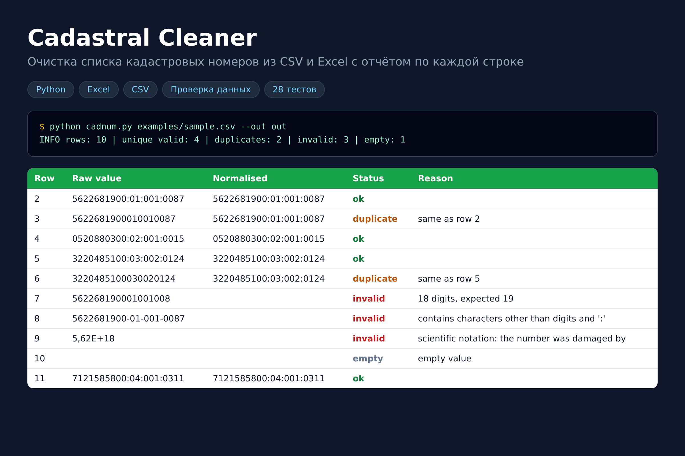
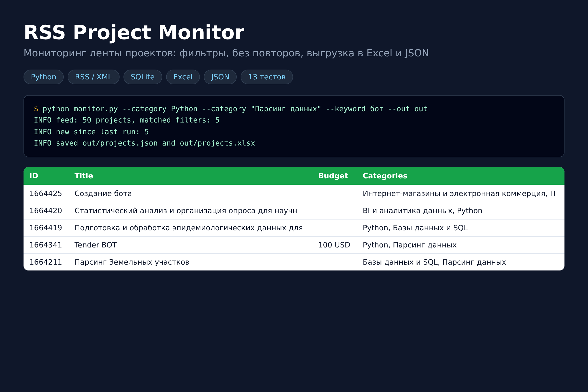

# Примеры работ

Небольшие проекты на Python: сбор и обработка данных, выгрузка в Excel и JSON.
Каждый проект запускается одной командой и покрыт автоматическими тестами.

## Cadastral Cleaner

Очистка и проверка списка кадастровых номеров из CSV и Excel с отчётом по
каждой строке. [Код и инструкция](cadastral-cleaner)

## RSS Project Monitor

Мониторинг RSS-ленты проектов с фильтрами, защитой от повторов и выгрузкой в
Excel и JSON. [Код и инструкция](rss-project-monitor)

