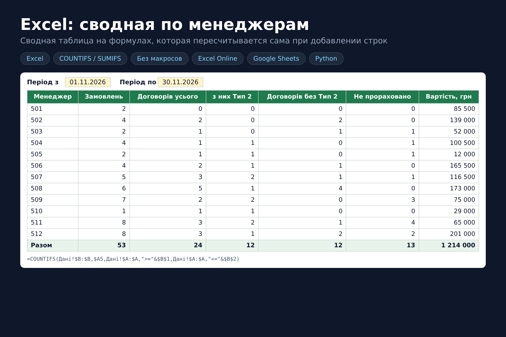

# Excel: сводная по менеджерам

Таблица Excel, в которой сводка по менеджерам считается формулами и
обновляется сама, когда в данные добавляют новые строки.



## Что внутри

Готовый файл: [report.xlsx](report.xlsx).

- Лист **«Дані»** — по одной строке на заказ: дата, менеджер, номер заказа,
  стоимость, тип договора, отметка «прораховано».
- Лист **«Зведення»** — по каждому менеджеру за выбранный период:
  количество заказов, количество договоров, из них договоров типа 2,
  договоров без типа 2, количество непросчитанных заказов и сумма.

## Как это работает

- Период задаётся двумя датами в жёлтых ячейках. Меняете даты — таблица
  пересчитывается.
- Формулы охватывают столбец целиком, поэтому новые строки попадают в расчёт
  без протягивания формул.
- Тип договора и отметка «прораховано» выбираются из выпадающего списка,
  чтобы опечатка не сломала подсчёт.
- Только стандартные функции `COUNTIFS` и `SUMIFS`, без макросов. Такие
  формулы поддерживаются в Excel, Excel в Интернете и Google Таблицах.

## Как проверено

Файл собирается скриптом `build.py`. Тесты открывают его в LibreOffice,
пересчитывают формулы и сравнивают каждое число сводки с тем же расчётом,
выполненным независимо на Python:

- все менеджеры за полный период;
- другой период — цифры меняются вместе с датами;
- контрольный пример: у менеджера 2 заказа, 1 договор и 1 непросчитанный.

```bash
pip install -r requirements.txt
python build.py report.xlsx
python -m pytest
```

Для тестов нужен установленный LibreOffice.
